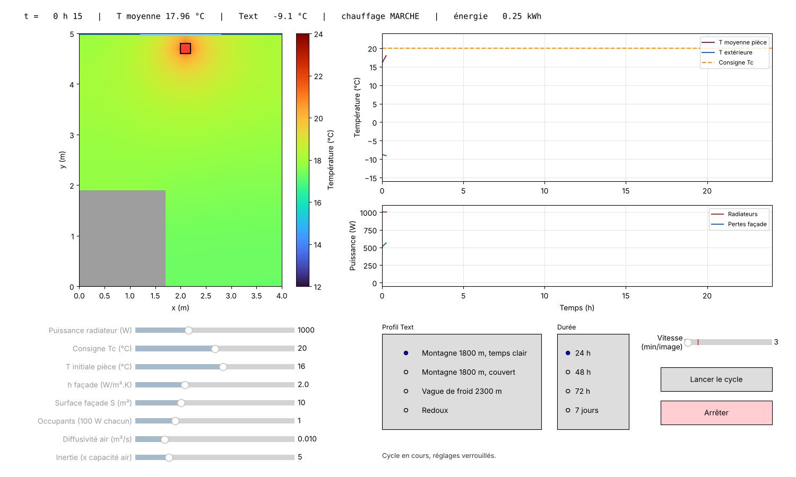
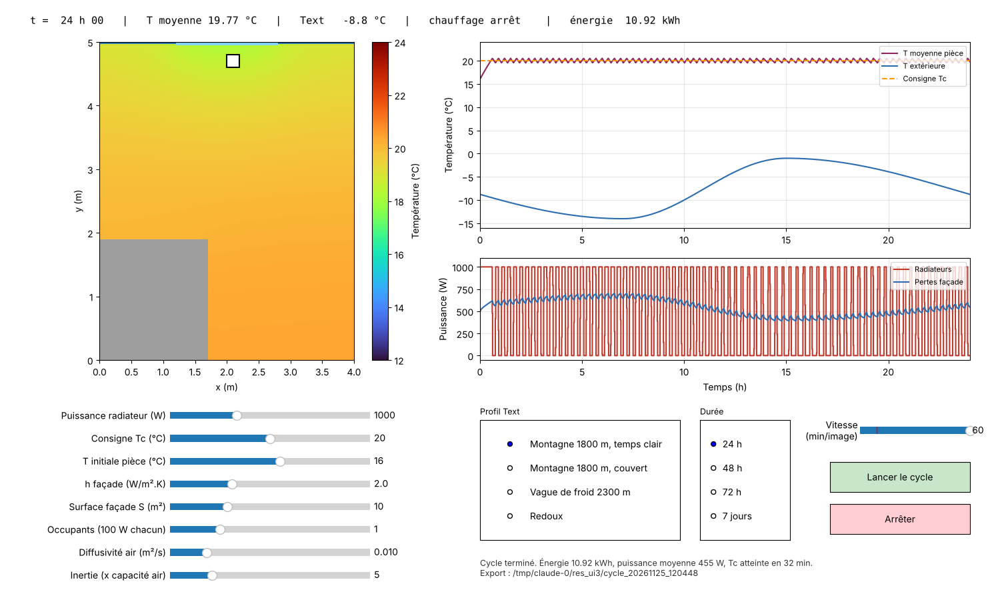

# Simulateur de chauffage d'une pièce

Simulation en 2D (vue de dessus) du chauffage d'une chambre d'hôtel en montagne. Le programme calcule la répartition de la température dans la pièce, régule les radiateurs en tout ou rien sur la température moyenne, et mesure l'énergie consommée pour maintenir une consigne Tc pendant un ou plusieurs jours d'hiver.

Ce simulateur fait partie du projet de chauffage intelligent (Arts et Métiers Aix-en-Provence, client STMicroelectronics). Il servira ensuite à produire des données pour l'IA et à comparer plusieurs stratégies de pilotage.



Fin d'un cycle de 24 h (profil « Montagne 1800 m, temps clair ») :



## Installation

Il faut Python 3.11 ou plus récent.

```
pip install -r requirements.txt
```

## Utilisation

Lancer l'interface avec la chambre type :

```
python -m simulateur_chauffage
```

Ou avec une autre pièce :

```
python -m simulateur_chauffage pieces/ma_piece.toml
```

Dans la fenêtre, on règle les paramètres avec les curseurs, on choisit un profil de température extérieure et une durée, puis on clique sur « Lancer le cycle ». Pendant le cycle, les réglages sont verrouillés (seule la vitesse d'animation reste modifiable). À la fin, les résultats sont exportés automatiquement dans le dossier `resultats/`. Le bouton « Arrêter » interrompt le cycle sans rien exporter.

Pour enchaîner des cycles sans interface (plus rapide, pratique pour faire beaucoup de simulations) :

```
python -m simulateur_chauffage.cli --profil "Vague de froid 2300 m" --duree 48 --puissance_radiateur 1500
```

`python -m simulateur_chauffage.cli --help` donne la liste de tous les réglages.

## Ce qui est exporté

Chaque cycle crée un dossier `resultats/cycle_AAAAMMJJ_HHMMSS/` qui contient :

- `resume.csv` : les indicateurs du cycle (temps pour atteindre Tc, énergie consommée en kWh, puissance moyenne, taux de fonctionnement, nombre de démarrages, énergie perdue par la façade, températures) et les paramètres utilisés ;
- `series.csv` : l'évolution minute par minute (Text, température moyenne, min et max dans la pièce, part de la minute où le chauffage était en marche, puissances moyennes sur la minute, énergie cumulée). Comme ce sont des moyennes, la somme des puissances multipliées par la durée redonne exactement l'énergie du résumé ;
- `cycle.xlsx` : les mêmes données dans un classeur Excel, avec une feuille de courbes ;
- `courbes.png` : les courbes en image.

Le fichier `resultats/tous_les_cycles.csv` reçoit une ligne par cycle, ce qui permet de comparer facilement plusieurs essais.

Les CSV utilisent le point-virgule et la virgule décimale pour s'ouvrir directement dans Excel.

## Modèle physique

La pièce est découpée en mailles carrées (20 cm par défaut). Chaque maille est une colonne d'air sur toute la hauteur de la pièce. Pour chaque maille, on écrit le bilan d'énergie :

```
C dT/dt = C a / pas² × somme(T_voisine - T) + P_radiateur + P_occupants - P_pertes
```

- `C` est la capacité thermique de la maille. Celle de l'air seul est multipliée par un facteur d'inertie, parce que les meubles, le sol et les murs intérieurs stockent aussi de la chaleur. Sans ce facteur, la pièce chaufferait et refroidirait beaucoup trop vite.
- `a` est une diffusivité effective. La diffusion moléculaire de l'air (2 × 10⁻⁵ m²/s) est bien trop lente pour représenter une vraie pièce, où la chaleur est surtout transportée par les mouvements d'air. On prend donc une valeur plus grande (0,01 m²/s par défaut), à ajuster.
- Les pertes ne passent que par la façade, avec la loi de Newton : `P_pertes = h S (T - Text)`. Les autres murs ne laissent pas passer de chaleur, car les pièces voisines sont à une température proche. Le total `h S` est réparti sur les mailles collées à la façade, avec un poids plus fort devant les fenêtres (`poids_fenetre` dans le fichier de la pièce, 4 par défaut, car une fenêtre perd environ 4 fois plus qu'un mur isolé). Les pertes totales restent égales à `h S (T - Text)`, mais l'air froid se forme surtout devant la fenêtre. Par défaut, S vaut la surface du mur de façade lue dans le fichier de la pièce.
- Les occupants apportent 100 W chacun, répartis sur toute la pièce. Le soleil n'est pas pris en compte.
- Le thermostat allume tous les radiateurs quand la température moyenne passe sous Tc - 0,5 °C et les éteint au-dessus de Tc + 0,5 °C.

Le calcul avance par petits pas de temps (schéma explicite). Le pas est choisi automatiquement pour que le calcul reste stable. À chaque cycle, le programme vérifie que l'énergie stockée dans la pièce est bien égale aux apports moins les pertes (colonne `ecart_bilan_energie_pct` du résumé, qui doit rester proche de 0).

### Valeurs par défaut

| Paramètre | Valeur | Remarque |
|---|---|---|
| Puissance d'un radiateur | 1000 W | |
| Consigne Tc | 20 °C | |
| Température initiale | 16 °C | |
| h | 2 W/(m².K) | coefficient global de la façade (mur isolé et fenêtre) |
| S | 10 m² | façade de 4 m sur 2,5 m |
| Occupants | 1 | |
| Diffusivité effective | 0,01 m²/s | |
| Inertie | 5 | capacité réelle divisée par celle de l'air seul |

Ces valeurs sont arbitraires mais réalistes. Elles sont à ajuster avec les vraies données.

### Profils de température extérieure

Chaque profil suit une journée type d'hiver : minimum vers 7 h, maximum vers 15 h. Le même profil est répété chaque jour pour les cycles de plusieurs jours. Le cycle commence à minuit.

| Profil | Minimum | Maximum |
|---|---|---|
| Montagne 1800 m, temps clair | -14 °C | -1 °C |
| Montagne 1800 m, couvert | -7 °C | -3 °C |
| Vague de froid 2300 m | -22 °C | -12 °C |
| Redoux | -2 °C | 6 °C |

Ce sont des ordres de grandeur pour une station des Alpes du Nord en janvier. On pourra les remplacer par de vraies mesures (Météo-France) dans `simulateur_chauffage/profils.py`.

## Changer la pièce

La pièce est décrite dans un fichier TOML, sans toucher au code. Il suffit de copier `pieces/chambre_type.toml` et de modifier :

- les dimensions et le pas du maillage ;
- le côté de la façade (`nord`, `sud`, `est` ou `ouest`) ;
- les fenêtres (début et fin le long de la façade) et `poids_fenetre` ;
- les radiateurs (position x, y), autant qu'on veut ;
- les obstacles, c'est-à-dire les zones sans air (salle de bain, placard, mur intérieur). Plusieurs rectangles permettent de faire une pièce en L ou plusieurs pièces.

Le programme refuse une description incohérente : dimension qui n'est pas un multiple du pas, radiateur hors de la pièce ou dans un obstacle, fenêtre hors du mur, obstacle plus fin qu'une maille, poche d'air complètement isolée par des obstacles.

Repère : x va de l'ouest vers l'est, y va du sud vers le nord, en mètres, avec l'origine dans le coin sud-ouest.

## Organisation du code

| Fichier | Rôle |
|---|---|
| `piece.py` | lecture du fichier TOML et construction du maillage |
| `physique.py` | équations sur le maillage (diffusion, pertes, sources, pas de temps stable) |
| `regulation.py` | thermostat tout ou rien |
| `profils.py` | profils de température extérieure |
| `simulation.py` | boucle de calcul, bilan d'énergie, enregistrement des séries |
| `cycle.py` | déroulement d'un cycle complet |
| `resultats.py` | indicateurs de fin de cycle |
| `export.py`, `graphiques.py` | fichiers CSV, Excel et PNG |
| `widgets.py`, `vue.py`, `interface.py` | fenêtre matplotlib (commandes, affichage, déroulement) |
| `unites.py` | conversions d'unités |
| `cli.py` | lancement sans interface |

## Tests

```
python -m pytest
```

Les tests vérifient entre autres :

- la conservation de l'énergie par la diffusion et le bilan global à chaque cycle ;
- la stabilité du schéma (stable avec le pas choisi, instable 10 % au-dessus de la limite théorique) ;
- le refroidissement et la montée en température comparés à la solution exacte du modèle à une seule température ;
- l'équilibre avec les seuls occupants (100 W apportés, 100 W perdus) ;
- le fait que le résultat change peu quand on affine le maillage ou le pas de temps ;
- la cohérence entre les séries exportées et l'énergie du résumé ;
- le refus des descriptions de pièce incohérentes ;
- l'hystérésis du thermostat, les profils de Text, les exports et le verrouillage de l'interface.

## Limites actuelles

- Pas de soleil, pas d'échanges avec les chambres voisines.
- Les radiateurs sont ponctuels (une maille chacun) et tous commandés ensemble.
- Le chauffage de l'air par un radiateur est simplifié : pas de panache d'air chaud ni de stratification en hauteur.
- La diffusivité effective et l'inertie sont des paramètres de réglage, à caler sur des mesures quand on en aura.
